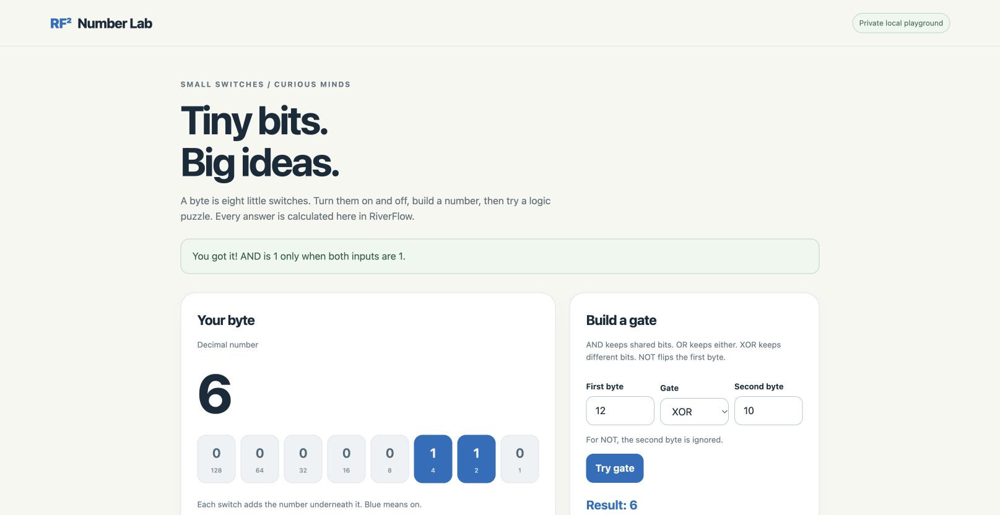

# RF² RiverFlow

### Readable source. Native programs. Bounded AI tools.

Created by **Ilangkhumanan Thirunavokkarasu** · Published by **SFE** · **MIT licence**

[Download](https://github.com/starkfiber/RiverFlow/releases/latest) · [Start here](docs/START-HERE.md) · [Codebase map](docs/CODEBASE.md) · [Read the book](https://starkfiber.github.io/RiverFlow/book/) · [MCP](plugin/skills/rf2/SKILL.md)


RiverFlow is a programming language with a compiler written in RiverFlow. Its Mac compiler emits ARM64 machine code directly. A separate development cross-compiler now emits ESP32-C3 RV32 machine code and ROM-loadable RAM images, qualified in Espressif QEMU. Native programs run without a Node, npm, Python or C++ runtime. An AI host can use the bounded MCP interface to check and run supported computations.

The goal is one readable language for application and systems work, with explicit effects and recoverable failures. The current implementation is a foundation for that goal. Its [capability map](docs/CAPABILITY-MAP.md) states what works and what remains missing.

## Start in five minutes

Download and unpack the latest Apple Silicon Mac release, then run these commands from its directory:

```sh
./rf2 status
./rf2 run examples/compact/sum.rf2 '[1,2,3]'
./rf2 mcp
```

The sum returns `6`. The last command starts the native MCP service over standard input and output. Follow [the host setup guide](docs/START-HERE.md#connect-an-ai-host) to connect it to an AI application.

To compile your own trusted systems program:

```rf2
profile RF2_SYSTEM_A64_V1
fn main(argc,argv)
 let answer=20+22
 return answer!=42
end
```

Save it as `program.rf2`. From a source checkout with a qualified native compiler:

```sh
./tools/build-program.sh /absolute/path/to/rf2c program.rf2 program-build --opt
./program-build/program
```

The program exits successfully. The build creates a new directory and signs the executable for local macOS execution. It never silently installs a toolchain.

## Choose your path

| You want to… | Start here |
| --- | --- |
| Learn the syntax | [Language and byte guide](docs/START-HERE.md#learn-the-language), [book](https://starkfiber.github.io/RiverFlow/book/) |
| Write a native file or text tool | [Examples](examples/), [ownership](docs/RESOURCE-OWNERSHIP.md), [text and bytes](docs/TEXT-BYTES.md) |
| Connect an AI assistant | [Native MCP setup](docs/START-HERE.md#connect-an-ai-host), [tool contracts](plugin/skills/rf2/SKILL.md) |
| Inspect smaller native images and function changes | [Compact images and working sample](docs/COMPACT-IMAGES-0.27.md) |
| Reuse unchanged native builds | [Incremental target builds](docs/INCREMENTAL-BUILDS.md) |
| Work on the compiler | [Compiler map](native/compiler/README.md), [contribution guide](CONTRIBUTING.md) |
| Test a performance claim | [Measurement guide](tools/README.md), [latest compiler experiment](docs/COMPILER-DISPATCH.md) |
| Understand platform and library gaps | [Capability map](docs/CAPABILITY-MAP.md), [full-stack direction](docs/RF2-FULL-STACK-DIRECTION.md) |

## What is available

**Stable package: 0.17.** Bounded Core computation, local modules, records, checked arrays, UTF-8 scalar views, typed outcomes, owned files, bounded growing bytes and nine defined MCP tools.

**Development source: 0.36 ESP32-C3 candidate.** The native RF2-written cross-compiler adds a bounded interrupt dispatcher, a private interrupt stack, register preservation and checked timer/watchdog leases. Two 600-second virtual-time firmware runs each handled over 60000 timer interrupts while preserving the expected foreground result. Thirty interrupt/lease controls and the existing compiler, UART, sensor and timer regressions passed. **Physical board and sensor validation remain pending.** See [contracts, failures and exact evidence](docs/ESP32C3-INTERRUPTS-0.36.md) and the [native development bundle](dist/0.36-candidate/README.md).

The new bundle includes the shared timer/watchdog libraries and interrupt heartbeat. Earlier [0.34 images and evidence](docs/ESP32C3-0.34.md), [timer qualification](docs/ESP32C3-TIMERS.md) and [Arduino MCP reference lessons](docs/ARDUINO-MCP-REVIEW.md) are retained. The emulator protection gap and unmodeled RTC watchdog remain explicit. Checked library leases are not a raw-MMIO sandbox, linear ownership types or universal MCU support.

[0.33 heap collections and shared applications](docs/HEAP-COLLECTIONS-0.33.md) and [0.32 larger fixed arrays](docs/STRUCTURED-STORAGE-0.32.md) remain available. Stable downloads are separate and unchanged. The cross-compiler host is still Apple Silicon macOS; x86, Linux applications, other ESP32 variants and arbitrary Arduino/Pico firmware are not implemented.

MCP does not grant arbitrary filesystem, network or systems-code execution. AI intelligence comes from the connected host. There is no embedded model or automatic proof of correctness.

## Inside the repository

| Directory | Purpose |
| --- | --- |
| [`native/`](native/) | RF2 compiler, runtime and native application code |
| [`examples/`](examples/) | Complete programs and capability demonstrations |
| [`tests/`](tests/README.md) | Native acceptance tests, independent oracles and regressions |
| [`plugin/`](plugin/) | Native MCP launchers and host skill |
| [`tools/`](tools/README.md) | Explicit build, measurement and publishing tools |
| [`docs/`](docs/CODEBASE.md) | Contracts, current guides and retained evidence |
| [`bootstrap/`](bootstrap/), [`src/`](src/) | Historical seed and JavaScript reference implementation |
| [`site/`](site/), [`book/`](book/) | Website and book sources |

Existing paths stay compatible. Developer test and publishing tools use other languages; those are distinct from native user runtime dependencies. [Full map and build flow](docs/CODEBASE.md) · [Source inventory](docs/SOURCE-INVENTORY.json).

## Make an improvement we can verify

Bring a complete program, an expected result and a reproducible failure. Keep a baseline, test refusal paths and report mixed results. Some RF2 optimizations remove repeated work; others still trail specialised C or general-purpose libraries. There is no universal speed or model-token claim.

Read [CONTRIBUTING.md](CONTRIBUTING.md), then choose a bounded task from the [roadmap](docs/RF2-FULL-STACK-DIRECTION.md). New targets, concurrency, richer allocation and library compatibility need real implementations and target-specific tests.

[MIT licence](LICENSE) · [Release history and experiments](docs/RESEARCH-HISTORY.md) · [External review brief](docs/EXTERNAL-REVIEW-BRIEF.md)

## Try a native learning app

[Number Lab](examples/number-lab-web/) makes binary switches, hex, ASCII and logic gates interactive. Its server and calculations compile from RF2; the browser renders ordinary HTML/CSS. See the separate [CLI game](examples/number-lab/) and [measured development results](docs/FUNCTION-REUSE-0.29.md).


