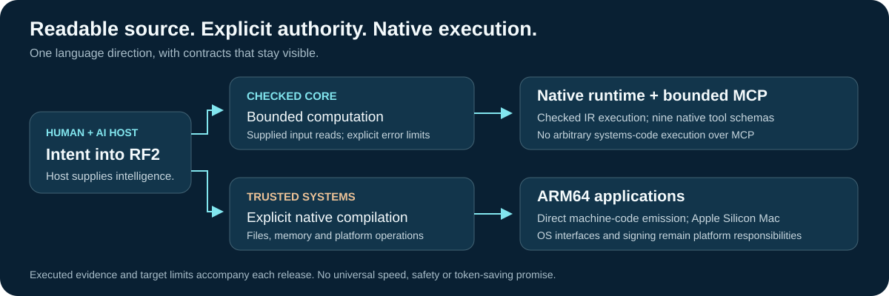
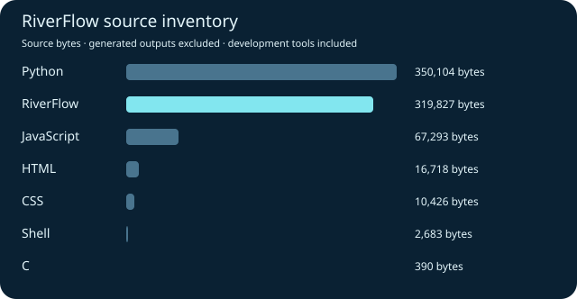

# RF² RiverFlow

### Readable programs. Explicit effects. Native tools.

Created by **Ilangkhumanan Thirunavokkarasu** · Published by **SFE** · **MIT licence**

[Download](https://github.com/starkfiber/RiverFlow/releases/latest) · [Read the book](https://starkfiber.github.io/RiverFlow/book/) · [Language capability map](docs/CAPABILITY-MAP.md) · [Byte and ASCII reference](docs/BYTE-REFERENCE.md) · [MCP skill](plugin/skills/rf2/SKILL.md)


RiverFlow turns readable source into useful native programs. Its compiler emits ARM64 machine code directly. The compiler, runtime and application controllers are written in RF2. An AI host can work through the bounded MCP interface; intelligence is supplied by the host, with deterministic language rules around what runs.

**The direction:** one understandable language for application and systems work. Each capability ships with its input contract, failure behavior, target limits and executed evidence.

## Research direction: make results challengeable

The [Evidence Contract candidate](docs/EVIDENCE-CONTRACT.md) combines five tested mechanisms in a native RF2 application: permission and work checks, atomic byte transformations, independent execution, source-bound SHA-256 receipts and self-contained replay capsules. [Further tests and measured overhead](docs/CONTRACT-REPLAY-RESEARCH.md) retain shared-defect and unsigned-receipt negative controls. It is a research candidate built with 0.17, separate from the released package. These mechanisms have [established prior art](docs/FIVE-HYPOTHESES-REVIEW.md); their integration is the experiment.

The [ten-language source audit](docs/TOP-TEN-LANGUAGE-AUDIT.md) compares RF2 with selected implementations from Python through C, SQL and Go, with assembly as a separate low-level reference. It includes an A–Z acceptance ledger and marks missing capabilities explicitly. Popularity and shorter spelling do not prove correctness, speed or adoption.

## 0.21 development: owned mappings and authenticated guest entry

RF2 now owns guest mapping lifetimes and authenticates a fixed boot contract with shared-key HMAC. The final local suite passed 34 guest runs, 77 refusals, 23 mapping scenarios in both compiler modes and six controlled fault substitutions. A stronger test found an older HVC #0 counterexample; the current profile requires HVC #1. [Contract and limits](docs/BOOT-CONTRACT-0.21.md).

RF2 is not a complete Python/C/assembly replacement or universally faster. Fresh task, HTTP and MCP measurements retain both wins and losses, including the slower RF2 repeated-hash path. [Benchmark tables and raw reports](docs/BENCHMARKS-0.21.md) · [Capability gaps](docs/CAPABILITY-MAP.md).

## 0.20 development: owned VMs and bounded guest images

RF2 now checks VM/vCPU ownership, validates a small guest-image format and enforces a virtual-timer time slice for admitted looping guests. The final local suite passed 136 guest executions, 31 image refusals, 52 branch-admission checks and 14 ownership scenarios in both compiler modes. MCP authority is unchanged. [Implementation, clock correction and limits](docs/VM-OWNERSHIP-0.20.md) · [Run the native image loader](examples/vm-runner/README.md).

## 0.19 foundation: direct guest control and portable computation

RF2 now emits explicit Hypervisor framework bindings and runs its own bounded VMM program without QEMU. Forty local guest runs cover arithmetic, permission faults, cleanup and same-process VM reacquisition. Apple supplies hardware virtualization; Linux boot and devices remain future work.

The native RF2 WebAssembly encoder passed 588 differential cases across generic and optimized modes. A guarded sum specialization reduced its selected local WASM medians by 63–66%; the simpler JavaScript baseline remained slightly faster for 64 words. [Evidence, losses and next gates](docs/FOUNDATION-0.19.md) · [Try the browser lab](https://starkfiber.github.io/RiverFlow/lab/) · [Cloud candidate and free-service boundaries](docs/FREE-CLOUD-0.19.md).

The browser uses compiled WASM when available and labels its limited JavaScript fallback. Android 4.1 device compatibility and Cloudflare deployment are not claimed. Existing MCP authority is unchanged.

## Frozen 0.18 development candidate

A separate native verifier, HMAC-authenticated receipts and three bounded contract MCP tools are working. The eligible XOR/reversal path has matched before/after measurements; complete authenticated MCP timings are recorded separately. [Trust model, setup and measured evidence](docs/TRUST-0.18.md).

Shared-key authentication is not a public signature or proof of uncompromised hardware. The separate algorithm catches the tested two-path defect; a shared three-path defect still escapes. Stable downloads remain 0.17. The separate [0.18 native candidate bundle](dist/0.18-candidate/) contains the trust service, verifier, compiler, website and VM controller, with a pinned checksum. It is ad-hoc signed, not notarized.

## Now running: one website, three execution paths

A native RF2 server, host Python control and Python inside a real HVF Linux guest serve the same page and checked computation. RF2's VM controller launches QEMU; QEMU supplies virtualization. The two local 3,600-response comparisons and their confounders are [fully recorded](docs/STACK-LAB-0.18.md). A second hosted ARM Mac also exposed and verified a fix for the compiler's macOS 15 loader metadata. The exact candidate archive passed local and hosted checks; stable downloads remain 0.17.

## Start with something real

The Apple Silicon Mac package contains ready-to-run tools. Users need no Node, npm, Python or C++ runtime.

```sh
./rf2 status
./rf2-buffer-audit document.bin
./rf2-file-kind document.bin
./rf2-hex document.bin
printf 'Hello world\n' | ./rf2-unicode-lines
./rf2 run examples/compact/sum.rf2 '[1,2,3]'
```

The document auditor handles UTF-8 rows, reports malformed input and continues with later valid text. It distinguishes byte counts from Unicode scalar counts. The compact sum returns `6`.

| Build or use | What works | Open the example |
| --- | --- | --- |
| Larger byte collections | Bounded growing byte vectors and small report records returned by value | [Buffered audit](examples/buffer-audit/), [storage/results](docs/STORAGE-RESULTS.md) |
| Owned file applications | Noncopyable file owners, typed I/O and visible cleanup errors | [Hex inspector](examples/hex/), [ownership contract](docs/RESOURCE-OWNERSHIP.md) |
| Text and byte processing | Checked arrays, strict UTF-8 views, scalar indexing and recoverable row validation | [Unicode auditor](examples/unicode-lines/) |
| Reusable native programs | Local modules, nominal records, functions and explicit file I/O | [Workload analyser](examples/workload/) |
| Checked computation | Bounded u32 Core, scalar helpers and explicit checked/wrapping arithmetic | [Core contract](docs/NATIVE-CORE.md) |
| Document applications | File revisions, exact integer totals, direct PDF output and graphical forms | [RiverFlow Studio](docs/GRAPHICAL-EDITOR.md) |
| AI tool integration | Nine native MCP tools with defined effects and prepared-plan lifecycle | [MCP interface](plugin/skills/rf2/SKILL.md) |

## Read it, compile it, inspect it

```rf2
profile RF2_SYSTEM_A64_V1
fn main(argc,argv)
 let ascii_a=0x41
 return ascii_a!=65
end
```

```sh
./tools/build-program.sh ./rf2c program.rf2 program-build --opt
./program-build/program
```

This complete systems program exits `0` when the byte values agree. The build script creates a new directory and applies normal macOS signing; it does not execute the result. [Hex, ASCII and byte order](docs/BYTE-REFERENCE.md) explain the representation. [The capability map](docs/CAPABILITY-MAP.md) separates released features from the wider roadmap.



## Connect an AI host

```sh
./rf2 mcp
```

Native tools: `rf2_status`, `rf2_check`, `rf2_run`, `rf2_lower`, `attendance_export`, `invoice_total`, `invoice_prepare`, `invoice_apply`, `invoice_release`.

MCP accepts bounded computation and defined application inputs. It does not expose arbitrary file paths, network access or systems-code execution. Lowering returns source; compiling a trusted program is an explicit developer action. The plugin launches an existing native binary and never silently builds, downloads or falls back to Node.

## Evidence stays beside the code

**0.17 adds growable byte vectors and record-valued results.** A native buffered audit loads a file, inspects retained bytes and returns a four-field report by value. Growth is bounded within a declared virtual reservation, and cleanup/error behavior remains explicit. [Storage/result contract](docs/STORAGE-RESULTS.md) · [Release receipt](docs/RELEASE-0.17-VERIFICATION.json).

The [second opinion and roadmap](docs/SECOND-OPINION-ROADMAP.md) compares pinned primary CPython, OpenJDK and LLVM sources by layer. The [external AI review brief](docs/EXTERNAL-REVIEW-BRIEF.md) is ready to copy into another reviewer, with reproducible acceptance gates and no blanket parity claims.

Independent storage, result and app probes sit beside compiler/runtime/MCP qualification. Earlier failures remain recorded. The historical WhatIF 0.15 HTTP check is separate from current compiler semantics. The updated book explains the design and remaining limits.

Performance is workload-specific. Some guarded reductions remove repeated work; other workloads remain slower than mature compilers. Encoded interface counts are not billed model usage. [Measurement method and limits](docs/LANGUAGE-MEASUREMENTS.md).

## Build the next foundation

```sh
./rf2c native/compiler/compiler.rf2 next-rf2c
/usr/bin/codesign -s - --force next-rf2c
./tools/build-runtime.sh ./next-rf2c next-runtime
```

The native rebuild uses RF2 plus OS file/signing utilities. Python, JavaScript, C references and publishing tools remain development dependencies. Current native qualification is Apple Silicon macOS. Android, iOS, web, x86, boot, concurrency and optical/GPU integration need separate implementations and target tests. RF2 does not yet replace every mature language ecosystem.

Bring a small complete program, a precise expected result and a reproducible failure. Contributions should preserve the original oracle and report both improvements and remaining gaps.

## Repository source inventory

This counts native RF2 source, developer oracles, tests and website tools. It does not describe what users must install to run a native RF2 program. Generated copies are excluded with their derivation retained.



[Inventory method and exact file list](docs/SOURCE-INVENTORY.json) · [Full-stack direction](docs/RF2-FULL-STACK-DIRECTION.md) · [Source inventory](docs/SOURCE-INVENTORY.json) · [MIT licence](LICENSE)
