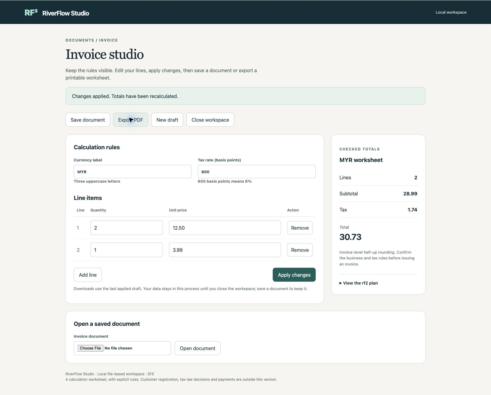

# RF² RiverFlow

**Readable plans. Checked computation. Native tools.**

Created by **Ilangkhumanan Thirunavokkarasu**. Published by **SFE**.


RiverFlow is a language for readable application plans and explicit systems programming. Its own compiler emits ARM64 machine code. The compiler, runtime, document handlers and new graphical workspace are written in RiverFlow. The AI host supplies intelligence through a bounded MCP interface.

**0.9: RiverFlow Studio** opens an editable local workspace for line items, exact decimal prices, checked totals, saved documents and PDF export. The Mac app launches an RF2 controller and displays its forms in your browser.

[Download 0.9](https://github.com/starkfiber/RiverFlow/releases/tag/v0.9.0) · [Read the book](https://starkfiber.github.io/RiverFlow/book/) · [Language roadmap](docs/LANGUAGE-ROADMAP.md) · [Measured results](docs/STUDIO-MEASUREMENTS.md)

## Open RiverFlow Studio

Download and unzip the Studio app for Apple Silicon Mac, then open it. The current build is ad-hoc signed, not notarized; macOS may require a normal user approval. The command-line package also provides `./rf2 editor --open`.



The release targets macOS ARM64. General Core computation, direct systems compilation, private platform I/O and bounded application effects are implemented. Additional machine targets and general application libraries are planned, with executable qualification required for each.

## Start with a real operation

This is a complete versioned application plan:

```rf2
rf2 app v1
invoice total
currency MYR
tax 600 bps
```

With the downloaded Apple Silicon Mac package:

```sh
./rf2 app capabilities/invoice.total.v1/quote.rf2 \
  capabilities/invoice.total.v1/test-lines.json
```

The supplied programming fixture returns subtotal 2899 cents, tax 174 cents and total 3073 cents. The rate is an explicit input, not tax advice. Line multiplication and subtotal run through a compiled Core helper/loop. Invoice-level rounding and checked bounds are specified, not guessed. [Input rules, effects and limitations](capabilities/invoice.total.v1/README.md).

For attendance CSV export:

```sh
./rf2 attendance capabilities/attendance.local.v1/test-records.json new-register.csv
```

Only an explicit new output file can be created. Existing files and symlinks are refused. Included TEST identifiers are programming fixtures, not participant data. [Attendance contract](capabilities/attendance.local.v1/README.md).

## Save, revise and print

```sh
./rf2 invoice save capabilities/invoice.total.v1/quote.rf2 \
  capabilities/invoice.total.v1/test-lines.json first.invoice.json
./rf2 invoice set first.invoice.json 0 2 250 edited.invoice.json
./rf2 invoice inspect edited.invoice.json
./rf2 invoice pdf edited.invoice.json worksheet.pdf
```

A file-based native workspace: explicit new-file revisions, checked totals and direct PDF output. The graphical editor shares this checked document model. Payment and tax-law determination are outside its contract. [Workspace contract](docs/INVOICE-WORKSPACE.md).

Prepare an immutable plan once, inspect its visible currency/tax rules, apply it to fresh lines, then release it. Up to 32 process-local plans; discard handles on reconnect. [MCP lifecycle](docs/PREPARED-PLANS.md).

[Graphical workspace and safety contract](docs/GRAPHICAL-EDITOR.md) · [Platform ABI](docs/PLATFORM-ABI.md)

## Compute and compile

A complete compact computation:

```rf2
rf2 v1 checked
sum input
```

```sh
./rf2 run examples/compact/sum.rf2 '[1,2,3]'
./rf2 check book/examples/example-4.flow
./rf2 run book/examples/example-4.flow '[2,3,4]'
./tools/build-core.sh ./rf2 ./rf2c book/examples/example-4.flow squares-build
./squares-build/program '[2,3,4]'
```

The helper example returns 29. `run` checks source and executes bounded IR in the native runtime. The explicit build route lowers checked Core to RiverFlow systems functions and compiles an ARM64 executable. These are distinct paths. Core permits only supplied input reads, checked/wrapping u32 operations, bounded loops and acyclic scalar helpers. Trusted systems source has a separate profile and authority. [Native Core boundary](docs/NATIVE-CORE.md).

## Connect MCP

```sh
./rf2 mcp
```

The native server exposes nine tools: `rf2_status`, `rf2_check`, `rf2_run`, `rf2_lower`, `attendance_export`, `invoice_total`, `invoice_prepare`, `invoice_apply`, `invoice_release`. Application tools return data without filesystem access. Lower returns source without compiling or writing it. The Codex plugin launches the installed native executable; it never falls back to Node or silently downloads/builds software. [Plugin skill](plugin/skills/rf2/SKILL.md).

## Evidence before claims

- Invoice: 630 successful comparisons, 108 comparisons with 0.6 Core, 39 refusals, 200 seeded plan mutations and five CLI cases. [Receipt](docs/INVOICE-0.9-VERIFICATION.json).
- Core: 1095 execution comparisons and 317 admission checks. [Receipt](docs/GENERAL-CORE-0.9-VERIFICATION.json).
- Direct kernels: 18 builds and 163 executed cases. [Receipt](docs/DIRECT-KERNEL-0.9-VERIFICATION.json).
- Compact: 1016 compatibility comparisons, input guards and transport mutations. [Receipt](docs/COMPACT-0.9-VERIFICATION.json).
- Attendance: 34 successful exports/calendar cases, 45 refusals and three file-protection checks. [Receipt](docs/ATTENDANCE-0.9-VERIFICATION.json).
- Compiler: native fixed point, independently expected results and full runtime byte comparison with the historical encoder. [Receipt](docs/NATIVE-COMPILER-0.9-VERIFICATION.json).

The final 0.9 comparison with 0.8 shows similar invoice performance and no matched prepared-exchange token reduction. Earlier 0.7/0.8 results are preserved as historical experiments. **No general speed, energy or AI-task token-saving claim is established.** [Current method and results](docs/STUDIO-MEASUREMENTS.md).

Current native qualification is Apple Silicon macOS. There is no independent security audit, universal platform support, field outcome or model council approval. The retained JavaScript/C reference, Python bootstrap/tests and publishing tools are developer dependencies, not user runtime requirements. Naming research projects does not establish hardware integration or scientific novelty.

## Rebuild and improve

```sh
./rf2c native/compiler/compiler.rf2 next-rf2c
/usr/bin/codesign -s - --force next-rf2c
./tools/build-runtime.sh ./next-rf2c next-runtime
```

The build composes nine RiverFlow runtime modules. It invokes no Python, Node, C/C++ compiler, assembler or linker. macOS signing and platform interfaces remain external dependencies. The systems compiler now admits at most 256 functions, with accepted upper-bound executions and refusal at 257. [Build scope](docs/NATIVE-COMPILER.md).

The revised book has 21 numbered chapters, worked examples, application contracts, failures and measurements. Original code and text use the MIT licence. Referenced projects and dependencies retain their own licences.

## Why the GitHub language bar looks different

GitHub uses Linguist's supported-language list, which does not yet include RiverFlow. Generated book HTML and generated kernels are marked accurately in `.gitattributes`. We do not relabel RiverFlow as another language or hide the reference tools. This project-owned inventory counts RiverFlow source explicitly, alongside development and website code. [Method and file list](docs/SOURCE-INVENTORY.json) · [GitHub language documentation](https://docs.github.com/en/repositories/managing-your-repositorys-settings-and-features/customizing-your-repository/about-repository-languages).


## Research direction

Kernel 8/9, Developmental AI, Tamil Time Continuum, VOIKE, RU'OS and the human-AI workplace study motivate testable questions. Their names are not implementation evidence. Next: profile large invoice inputs, independently review the compiler/parser, qualify more targets and measure complete AI tasks with real usage receipts. Keep each claim linked to its actual source, test and limitation.

### Release 0.9 qualification

The editor suite passed seven edit cases, 150 refusal cases, five document round trips, a 1,000-line upload, idle-connection concurrency and byte-exact PDF comparison with 0.8. Platform tests execute process creation, six-argument memory calls and error handling. Existing Core, invoice, attendance, workspace, prepared-plan, compiler and official MCP SDK checks were rerun. [Editor receipt](docs/EDITOR-0.9-VERIFICATION.json) · [Platform receipt](docs/PLATFORM-0.9-VERIFICATION.json).

The 1,000-line MCP median was 2,733.86 µs versus 2718.92 µs in 0.8 on the tested host. The full editor HTTP transaction was 19,174.67 µs, excluding browser layout. Matched 100-call prepared transcripts range from 14,583 to 14,685 o200k tokens; two pairs match and one 0.9 transcript costs 102 more. This release adds capability; it does not establish faster computation or lower model bills.
