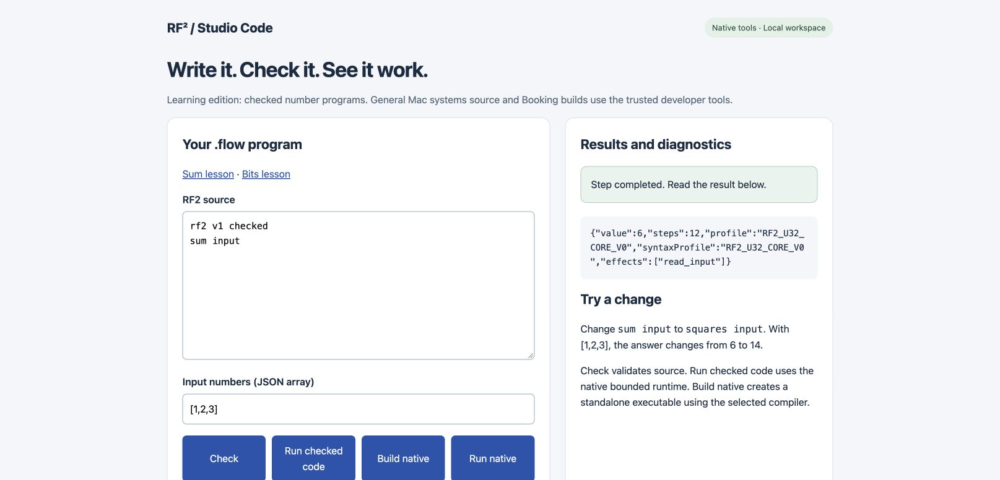
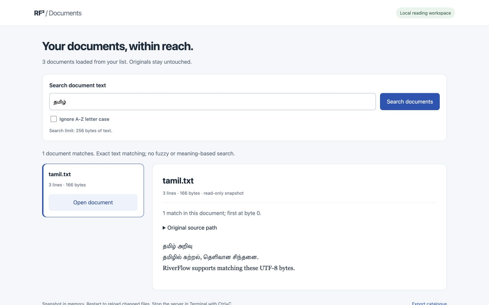
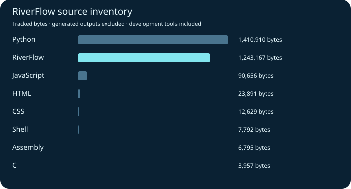
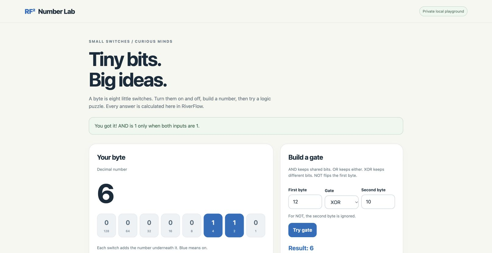

# RF² RiverFlow

### Readable source. Native programs. Bounded AI tools.

Created by **Ilangkhumanan Thirunavokkarasu** · Published by **SFE** · **MIT licence**

[Download](https://github.com/starkfiber/RiverFlow/releases/latest) · [Start here](docs/START-HERE.md) · [Codebase map](docs/CODEBASE.md) · [Learn RF2](https://starkfiber.github.io/RiverFlow/learn/) · [Platform direction](docs/RF2-EVERYWHERE.md) · [Development progress](docs/PROGRESS.md) · [MCP](plugin/skills/rf2/SKILL.md)


RiverFlow is a programming language with a compiler written in RiverFlow. Its Mac compiler emits ARM64 machine code directly. A separate development cross-compiler now emits ESP32-C3 RV32 machine code and ROM-loadable RAM images, qualified in Espressif QEMU. Native programs run without a Node, npm, Python or C++ runtime. An AI host can use the bounded MCP interface to check and run supported computations.

The goal is one readable language and SDK across learning, apps, devices and system software, including a future RU’OS integration. We will compete through complete applications and measured comparisons. [RF2 everywhere](docs/RF2-EVERYWHERE.md) connects that ambition to concrete engineering gates; the [capability map](docs/CAPABILITY-MAP.md) records what works today.

## Learn RF2 from zero

[First Learning Edition](book/learning-edition-1/README.md): 24 short chapters, runnable examples, exercises, answers and a clear boundary between working features and proposals. [Evolution specification](docs/RF2-EVOLUTION.md) records the next engineering gates.

## Build a booking app. Try the learning IDE.

The [Workbench 0.38 development edition](dist/workbench-0.38/README.md) adds a native one-room Booking app and RF2 Studio: edit, check, run and build supported Core programs in your browser. Booking shares reusable date/time, locked storage and form libraries with the local workspace. Overlaps, stale forms and failed saves have explicit outcomes. [Beginner walkthrough and tested limits](docs/BOOKING-STUDIO.md).

Studio is a bounded learning editor, not yet a general application IDE. The native compiler and MCP permission boundary remain unchanged. [Verification record](docs/WORKBENCH-0.38-VERIFICATION.json).



## Try the document workspace

[Download RF2 Documents](dist/documents-0.37/README.md), extract it and run this from the extracted folder:

```sh
./workspace examples/documents/fixtures/documents.txt --serve
```

Open the printed local URL. Search your explicitly supplied UTF-8 files, read previews, inspect source paths and export the in-memory catalogue. Originals stay untouched. A separate line-search CLI shares the same text/collection modules. This is a read-only Mac workspace, with 64-file/1-MiB corpus bounds; PDF extraction, editing and persistent indexing remain work. [Application guide](examples/documents/README.md) · [Reusable APIs](examples/documents/LIBRARIES.md).



## Start with a native application

Use the [first .flow application walkthrough](docs/FIRST-APP.md) for the exact download, checksum, setup and expected outputs. With the 0.36 native bundle extracted and this source checkout open:

```sh
export RF2_HOME="$HOME/Downloads/RF2-0.36-dev-macos-arm64"
sh tools/dev.sh doctor
sh tools/dev.sh check examples/collection-tools/telemetry-summary.flow
sh tools/dev.sh build examples/collection-tools/telemetry-summary.flow summary-build --opt
printf '9,1,9,3,2' | ./summary-build/program
```

The result is `{"count":5,"minimum":1,"maximum":9,"sum":24,"median_lower":3}`. Build directories must be new; checking and building never run the source application. The developer helper uses the explicitly selected native tools and ordinary macOS signing. It never downloads software or flashes a device.

For AI integration, [configure the native MCP host](docs/START-HERE.md#connect-an-ai-host). The runtime still reports **0.17.0** inside the 0.36 bundle because the nine-tool contract is unchanged; the development compiler has a separate scope. [Stable and development choices](docs/START-HERE.md#choose-a-package) are explicit.

## Choose your path

| You want to… | Start here |
| --- | --- |
| Learn the syntax | [Language and byte guide](docs/START-HERE.md#learn-the-language), [book](https://starkfiber.github.io/RiverFlow/book/) |
| Write a native file or text tool | [Example catalogue](examples/README.md), [ownership](docs/RESOURCE-OWNERSHIP.md), [text and bytes](docs/TEXT-BYTES.md) |
| Connect an AI assistant | [Native MCP setup](docs/START-HERE.md#connect-an-ai-host), [tool contracts](plugin/skills/rf2/SKILL.md) |
| Inspect smaller native images and function changes | [Compact images and working sample](docs/COMPACT-IMAGES-0.27.md) |
| Reuse unchanged native builds | [Incremental target builds](docs/INCREMENTAL-BUILDS.md) |
| Work on the compiler | [Compiler map](native/compiler/README.md), [contribution guide](CONTRIBUTING.md) |
| Test a performance claim | [Measurement guide](tools/README.md), [latest compiler experiment](docs/COMPILER-DISPATCH.md) |
| Understand platform and library gaps | [Capability map](docs/CAPABILITY-MAP.md), [full-stack direction](docs/RF2-FULL-STACK-DIRECTION.md) |

## What is available

**Stable package: 0.17.** Bounded Core computation, local modules, records, checked arrays, UTF-8 scalar views, typed outcomes, owned files, bounded growing bytes and nine defined MCP tools.

**Development apps: Workbench 0.38 and Documents 0.37.** Native Mac Booking, a Core learning editor and read-only document search share reusable libraries. [Select a package](docs/START-HERE.md#choose-a-package); each guide links its own acceptance evidence.

**Latest application candidate: 0.45.** [Typed multi-room Booking](docs/TYPED-BOOKING-0.45.md) shares real persistence and room rules across CLI, a light/dark browser GUI and a selected-journal MCP server. It uses the [0.44 recursive-owned-value compiler](docs/NESTED-OWNERS-0.44.md). Default/optimized tests cover independent snapshot decoding, schema migration, overlapping/concurrent writers, controlled failed/uncertain saves and bounded agent permissions. The [native development archive](https://github.com/starkfiber/RiverFlow/releases/tag/v0.45.0-dev) is published and its downloaded bytes were qualified again. Stable packages remain unchanged. The [fixed twelve-item ledger](docs/PROGRESS.md) records the remaining actual GitHub recognition gate. The [four-attempt construction comparison](docs/SDK-CONSTRUCTION-0.45.md) retains real usage and failures; no RF2 productivity advantage was established.

**Embedded development: 0.36 ESP32-C3.** A separate RF2-written backend has [emulator evidence](docs/ESP32C3-INTERRUPTS-0.36.md) for boot, UART, sensor-bus controls, timers and interrupts. Physical board and sensor validation remain pending.

The compiler host and qualified desktop target are Apple Silicon macOS. Windows, Linux/x86 applications, general mobile SDKs and arbitrary Arduino/Pico firmware remain work. The [target matrix](docs/RF2-EVERYWHERE.md#present-target-matrix) gives the next gate for each destination.

MCP does not grant arbitrary filesystem, network or systems-code execution. AI intelligence comes from the connected host. There is no embedded model or automatic proof of correctness.

## Inside the repository

| Directory | Purpose |
| --- | --- |
| [`native/`](native/) | RF2 compiler, runtime and native application code |
| [`examples/`](examples/README.md) | Catalogued learning, application, systems and embedded programs |
| [`experiments/`](experiments/nested-records/README.md) | Isolated unreleased compiler experiments |
| [`tests/`](tests/README.md) | Native acceptance tests, independent oracles and regressions |
| [`plugin/`](plugin/) | Native MCP launchers and host skill |
| [`tools/`](tools/README.md) | Explicit build, measurement and publishing tools |
| [`editors/`](editors/vscode/README.md) | Declarative language highlighting/snippets and honest Linguist preparation |
| [`docs/`](docs/README.md) | Documentation index, contracts and retained evidence; Pages publication |
| [`bootstrap/`](bootstrap/), [`src/`](src/) | Historical seed and JavaScript reference implementation |
| [`site/`](site/), [`book/`](book/) | Website and book sources |

Existing paths stay compatible. Developer tests and publishing tools use other languages; those are distinct from native user runtime dependencies. [Full map and build flow](docs/CODEBASE.md).

### Why GitHub shows Python

GitHub Linguist does not yet recognize RiverFlow. The compiler and runtime are RF2; many verification tools are Python. We keep both visible. Our inventory counts RF2 explicitly alongside the real development languages, excluding declared generated outputs. It is not a compatibility or performance score. [Method and upstream recognition path](docs/LANGUAGE-REPORTING.md) · [file and area breakdown](docs/SOURCE-INVENTORY.json).



## Make an improvement we can verify

Bring a complete program, an expected result and a reproducible failure. Keep a baseline, test refusal paths and report mixed results. Some RF2 optimizations remove repeated work; others still trail specialised C or general-purpose libraries. There is no universal speed or model-token claim.

Read [CONTRIBUTING.md](CONTRIBUTING.md), then choose a bounded task from the [roadmap](docs/RF2-FULL-STACK-DIRECTION.md). New targets, concurrency, richer allocation and library compatibility need real implementations and target-specific tests.

[MIT licence](LICENSE) · [Release history and experiments](docs/RESEARCH-HISTORY.md) · [External review brief](docs/EXTERNAL-REVIEW-BRIEF.md)

## Try a native learning app

[Number Lab](examples/number-lab-web/) makes binary switches, hex, ASCII and logic gates interactive. Its server and calculations compile from RF2; the browser renders ordinary HTML/CSS. See the separate [CLI game](examples/number-lab/) and [measured development results](docs/FUNCTION-REUSE-0.29.md).


