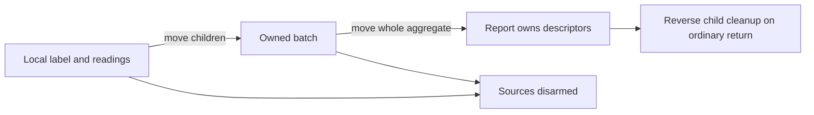

# Owned fields and local transfer, source candidate 0.42

15 November 2026. Baseline `43b1dd5708829b5e98ee530ffc894feb5eba54fb`. This is an isolated Mac ARM64 compiler candidate. The maintained compiler, stable packages, private papers and bounded MCP executable remain unchanged. [Source-bound receipt](OWNED-VALUES-0.42.json) · [implementation and reproduction](../experiments/owned-values/README.md).

## Working change

Records can explicitly own nominal text and u64 collection fields alongside scalar fields. Construction supports empty children or moves from existing local/field owners. Whole local aggregates and individual fields can be moved. Consumed typed bindings refuse reuse. The candidate adds validated Unicode-scalar text operations with recoverable allocation and access results; text and numeric collections cannot be interchanged.

The complete labelled-batch app uses the same numeric parser/statistics modules as existing applications. It accepts UTF-8 labels, including Tamil and emoji, transfers ownership twice, then emits a JSON summary. Empty readings produce count 0 and sum 0. Character counts are Unicode scalar counts. Invalid input and failed output return an error; partial stdout remains possible after a write failure.

## Ownership and failure contract

Each child has its own six-word descriptor and cleanup registration. Transfer carries active and pending mappings, disarms the source, and preserves nominal field types. Ordinary cleanup runs in reverse registration order, continues after a failed child retirement and preserves a primary error. A cleanup-only error reports `65536+errno`. A partially constructed aggregate does not become usable; children already acquired by it are cleaned on the construction error return. Earlier moved sources are not restored.

An explicit release can partly retire storage and retain pending ownership for retry. Moving that state must not resurrect a released mapping or lose pending ownership. Fatal traps/signals, raw memory/syscall interference and persistent kernel refusal remain outside infallible cleanup guarantees. Root/field moves are local; owner returns, transfer parameters and owned nested aggregates remain unimplemented. Text uses u64 cells for scalars, without compactness, normalization or grapheme guarantees.

## Executed evidence

| Check | Outcome | Scope |
| --- | ---: | --- |
| Owned-value/application controller | 460 passed assertions | Default/optimized builds, execution, refusals, fault cases and independent app expectations |
| Actual labelled-batch JSON comparisons | 280 executions | UTF-8, Tamil, emoji, combining/ZWJ sequences, escaped controls, empty data and fresh randomized scalar labels/readings |
| Controlled syscall-failure checks | 12 | Injected allocation/retirement/drop results in disposable images; not observed host OOM |
| Partial-construction cleanup | 2 in-process checks | A prior moved child is retired when a later runtime-closed source refuses transfer |
| Successful cleanup after moves | 2 in-process checks | Both child mapping addresses are nonzero and no longer mapped after ordinary return |
| Cleanup despite a peer failure | 2 in-process checks | Both mappings live before return; failed child's mapping remains observable, peer retires, error propagates; test then retires the retained mapping explicitly |
| Retained heap ownership / collection apps | 78 / 308 passed | Existing data, borrow, allocation and failure contracts |
| Retained borrowed application values | 687 passed | Earlier date/interval and nested-record scope |
| Owned app cache integration | Passed in both modes | Cold/warm packed images match clean builds; changing text limit 256 to 4 rebuilds correctly and rejects five scalars |
| Target and function caches | 56 / 79 passed | Existing clean-build equality, stale/corrupt cache and refusal controls |
| Register/OS ABI | 4 passed | Existing Mac ARM64 argument preservation, fork/wait, errno and mapping controls |
| Native MCP | Nine tools retained | Systems source refused; following bounded sum returns 6 |

The new candidate bootstrapped the maintained compiler through the existing independent encoder/runtime/official SDK controller. Separately, two native generations of the candidate's own source matched unsigned bytes. The maintained encoder requires spaced let/set assignments; both implementations also consumed the same narrowly normalized compiler source and matched output. The oracle was not modified. These are compiler-implementation checks, not an independent implementation or formal proof of the new ownership semantics.

The prepared candidate is 16,598,432 signed bytes. Fresh source preparation reproduced its source digest, and an existing destination refused without overwrite. No speed, energy or actual AI-usage benchmark ran for this feature.

## Reproduced defects and retained corrections

- The first candidate queried record metadata for scalar type zero. The type guard now checks for a record before looking up its kind.
- A new property condition used non-normalized bitwise truth and mishandled even-numbered type tags. It now compares explicit Boolean conditions.
- A moved-out field's property read initially compiled and trapped at runtime. Its current static access path refuses it, including property/borrow access; the old native fixture and error witness remain local.
- The batch app initially inherited a nonempty-statistics precondition and refused empty readings. It now emits a valid empty summary without changing the shared library's contract.
- Test-controller corrections fixed Python syntax, exact refusal-message matching, byte argv preservation and the no-fault release control. Their initial failed runs are retained; no native expected result was changed to excuse a failure.

Historical public regression receipts that older controllers rewrite were copied into this sprint's local evidence and restored to their original tracked bytes. The new summary links the current results instead of relabelling old release qualification.

## Next gate

This implements owned text/collection fields and **local** transfer in an isolated candidate. G1 remains active. Next: cross-function ownership return/transfer, richer composition, lifecycle/ABI specification and a real Booking persistence migration with independent failure tests. Promote a released compiler only after those declared gates and package qualification pass. No unrelated platform support or whole-language safety certification follows from this sprint.
