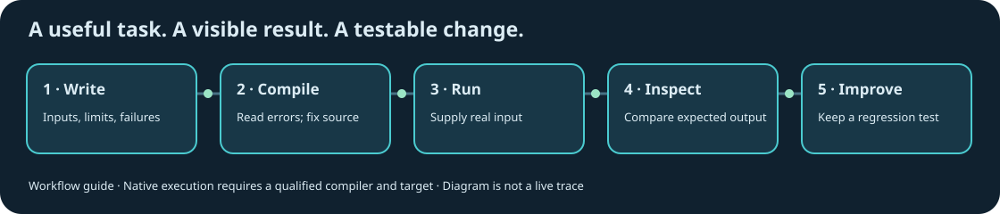

# Start using RiverFlow

## Choose a package

| Choice | Use it for | What it contains |
| --- | --- | --- |
| [Stable 0.17 release](https://github.com/starkfiber/RiverFlow/releases/tag/v0.17.0) | The frozen native runtime and its supported compiler examples | The release's original Mac tools and examples; not later collection or interrupt syntax |
| [Development 0.36 bundle](../dist/0.36-candidate/README.md) | This checkout's collection-app tutorial and ESP32-C3 interrupt examples | A development Mac compiler, ESP32-C3 compiler, the unchanged 0.17 MCP runtime and embedded examples |
| Source checkout | Reusable libraries, tutorials, build helpers and developer tests | Source files; a fresh clone does not build or install a native binary automatically |

The compiler host is Apple Silicon macOS. The Mac compiler emits ARM64 Mach-O applications; the separate ESP32-C3 compiler emits RV32 firmware. The `.flow` filename does not select a processor. Native compilers/runtime need no Node, npm, Python or C++ runtime. Binaries are ad-hoc signed, not notarized; actual qualification is on the recorded local Mac.

## Build your first application

Follow [Your first native .flow application](FIRST-APP.md). Select the extracted 0.36 bundle once with `RF2_HOME`, then use `sh tools/dev.sh doctor`, `check` and `build`. The tutorial executes two applications using the same parser/sort library, includes exact expected JSON and demonstrates invalid-input recovery.

The helper is shell developer tooling around the existing native binaries. It does not alter global PATH, install dependencies, overwrite old builds, run the resulting application or bypass macOS security prompts. [Direct commands](STANDALONE.md) remain available.

## Learn the language

Start with the [byte reference](BYTE-REFERENCE.md), [Core contract](NATIVE-CORE.md), [modules and records](MODULES-TYPES.md) and [online book](https://starkfiber.github.io/RiverFlow/book/). The book retains its edition's coverage; current versioned contracts describe subsequent additions.

Core/compact computation is deliberately bounded. Trusted Mac systems source supports different effects and uses the native compiler. Embedded source has another profile and compiler. Do not interchange their syntax or permissions.

For complete programs, inspect [collection tools](../examples/collection-tools/), [text search](../examples/text-search/), [Number Lab](../examples/number-lab/) and [file/byte inspection](../examples/hex/). The [capability map](CAPABILITY-MAP.md) separates working features and remaining gaps.

## Connect an AI host

Configure the host to launch the extracted native `rf2` executable with the argument `mcp`. Use an absolute executable path, for example `/your/extracted/RF2-0.36-dev-macos-arm64/rf2`, replacing the example with the actual location. For the plugin launcher, set `RF2_BIN` to that executable. The launcher never downloads, compiles or falls back to a JavaScript server. Use one registration route per client.

The nine stable tools are `rf2_status`, `rf2_check`, `rf2_run`, `rf2_lower`, `attendance_export`, `invoice_total`, `invoice_prepare`, `invoice_apply` and `invoice_release`. The runtime reports version 0.17.0 even inside the 0.36 development bundle. AI intelligence comes from the host. No arbitrary systems compilation, caller-controlled file/network access or device flashing is exposed through these tools. The separate development contract server has another contract; see [trust tools](TRUST-0.18.md).

For a manual stdio session from the checkout, `sh tools/dev.sh mcp` starts the same native server after checking the selected executable. It waits for protocol input; it is not a graphical chat window.

## Check before creating an executable

`sh tools/dev.sh check program.flow` invokes the selected compiler's `--check` mode. It validates the supplied trusted source and imports through code generation and relocation without writing an executable, cache, function map or report. It does not run the source program or prove runtime correctness. Imported programs report expanded-source locations explicitly. See [diagnostics](DIAGNOSTICS-0.31.md).

## Work on the compiler or another target

Read [the codebase map](CODEBASE.md) and [standalone build routes](STANDALONE.md). Select existing qualified native tools explicitly; `RF2_BOOTSTRAP_COMPILER` and `RF2_TEST_COMPILER` are developer verification inputs, not installation mechanisms. The historical package.json scripts exercise the JavaScript reference, not the default native user interface.

For firmware use [the ESP32-C3 guide](../examples/esp32c3/README.md). Emulation is not physical board qualification. For broader app work, [product proof gates](PRODUCT-PROOF-GATES.md) keep completed engineering separate from unmeasured learning, AI usage and business benefits.
