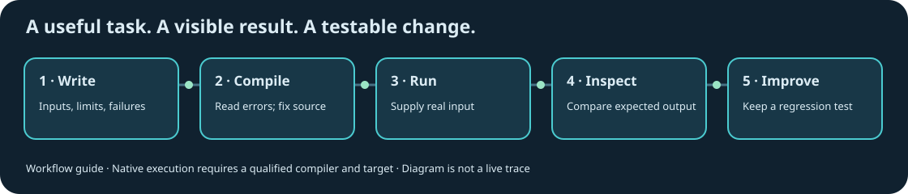

# Start using RiverFlow

## Run the stable native package

Download the Apple Silicon macOS package from the repository release page and unpack it. Run `./rf2 status` from that directory. The native user runtime needs no Node, npm, Python or C++ installation. Ad-hoc signing and macOS security handling are documented in STANDALONE.md; do not bypass a browser or operating-system warning automatically.

Try `./rf2 run examples/compact/sum.rf2 '[1,2,3]'`. The expected value is 6. This uses the bounded interpreter; it is not a newly compiled standalone program for each call.

## Learn the language

Start with the online book, BYTE-REFERENCE.md, NATIVE-CORE.md and MODULES-TYPES.md. Core/compact computation is deliberately bounded. The trusted systems profile adds native effects through a separate developer compilation route. Do not assume their permissions or syntax are interchangeable.

For complete programs, inspect `examples/hex`, `examples/unicode-lines`, `examples/buffer-audit` and `examples/workload`. The newer checksum example is development source and needs its qualified candidate compiler.

## Connect an AI host

Configure your host to launch the native executable with the argument `mcp`. Use an absolute executable path. For the plugin launcher, set RF2_BIN to that path. The launcher does not download, compile or fall back to a JavaScript server.

The nine stable tools are rf2_status, rf2_check, rf2_run, rf2_lower, attendance_export, invoice_total, invoice_prepare, invoice_apply and invoice_release. The host supplies intelligence. The executable validates bounded inputs and performs only its declared operations. The separate development contract server has a different tool set and trust contract; see TRUST-0.18.md.

## Build from native source

Read CODEBASE.md and STANDALONE.md. Use an explicit qualified rf2c to compile `native/compiler/compiler.rf2`, sign the result, then build a fresh runtime directory with `tools/build-runtime.sh`. RF2_BOOTSTRAP_COMPILER and RF2_TEST_COMPILER select existing compilers for developer verification; they are not installation or fallback mechanisms.

The package.json scripts run the historical JavaScript reference and its tests. They are developer tools, not the default native user interface.

## Build a small useful tool from development source

The development text-search example reads supplied text and reports exact byte matches. It uses a reusable native search module, rather than a compiler-recognized application template. See [the example's build and usage guide](../examples/text-search/README.md). Its limits, including the maximum query size and caller-owned workspace, are explicit. It is a CLI text tool, not PDF extraction, semantic search or a full document-management product.

When a compile fails, development 0.31 adds a nearby [source position](DIAGNOSTICS-0.31.md). Imported programs label expanded-source locations honestly. Keep the original error message: the nearby cursor helps you investigate but is not always the exact offending character.

[Product proof gates](PRODUCT-PROOF-GATES.md) separate working engineering examples from claims about developer productivity, AI usage, business value or platform compatibility. Those claims require their own measured complete tasks.

## Check a development program before creating an executable

With the qualified development compiler, run `rf2c --check program.rf2`. This validates the supplied source and imports through code generation and relocation, then returns without writing an executable, cache, function map or report. It never runs the source program. Check mode currently accepts exactly one source path and no options. It remains a trusted local compiler operation, not a new MCP permission or a sandbox for arbitrary files/devices. Successful checking does not prove the program will behave correctly when run.
