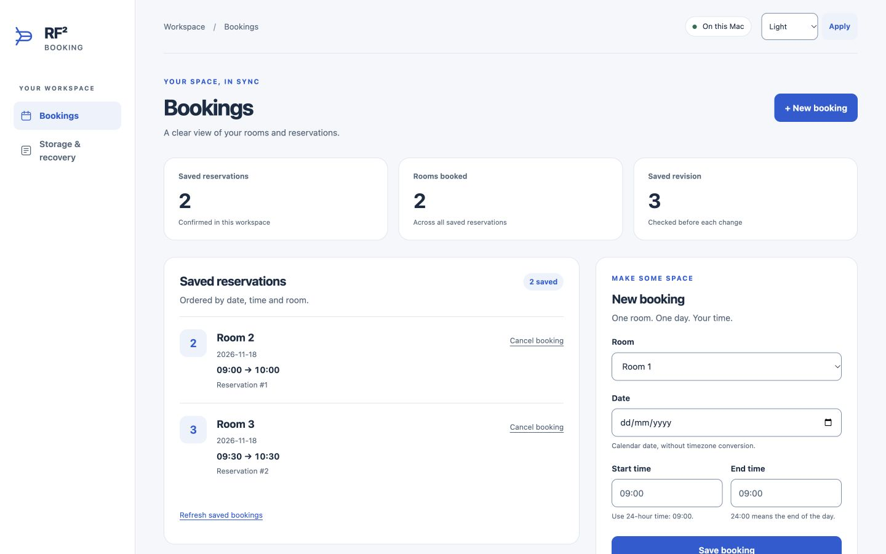

# RF2 typed Booking, development edition 0.45

Reviewed 15 November 2026. This application makes the owned-value work useful across a native CLI, a local browser GUI and a separate bounded agent server. All three import the same nominal Booking model and persistence implementation. The compiler is the source-pinned 0.44 recursive-ownership candidate. Existing stable downloads and the original nine-tool runtime remain distinct.

## What is implemented

The shared model is a nominal `Booking(id:u64,room:u64,day:u64,start:u64,finish:u64)` and an owned structured-row collection. Collection construction and decoding return an owned typed result. A decoder builds private rows and transfers ownership only after the complete file validates; partial failures clean the private collection. Raw pointers are never serialized.

Reservations use positive u64 IDs, rooms 1..16, Gregorian day ordinals 1..3652059 and half-open same-day minute intervals. Start is below finish, with finish at most 1440. Equal boundaries are adjacent and allowed. Different rooms/days are independent. Duplicate IDs refuse. There is no timezone conversion, recurrence, authentication, payment or production reservation claim. At most 256 current reservations and a 1 MiB journal are supported.

## Versioned persistence and transactions

Every append contains a complete checked snapshot: an 80-byte header, fixed-width typed rows, a 32-byte SHA-256 digest and an eight-byte commit marker. The header binds magic, version, schema identifier, exact payload length, monotonically increasing revision and previous snapshot digest. The reader checks structural bounds, every digest/link and every row's business rules before returning data. SHA-256 is **unkeyed integrity**, not an authenticated receipt or proof against an attacker who can rewrite the file.

Version 1 stores ID/day/start/finish and maps rows to Room 1; version 2 adds the room field. Both codecs are introduced by this development application. Migration explicitly appends a version-2 snapshot, preserves the old bytes and rejects a downgrade. **This does not import the older Workbench `RF2BOOK1` event journal.** That format is refused rather than guessed.

Writers take an exclusive nonblocking cooperative lock, validate the selected regular single-link file, compare the expected revision, apply the shared rules, append the full snapshot and synchronize it. Reads use a shared lock. A stale browser/agent/CLI write does not overwrite a newer reservation. Separate processes racing the same revision have exactly one confirmed winner; nonconflicting clients can reread/retry with a new revision. This is not hostile same-user path isolation or distributed database concurrency.

The outcomes are deliberately distinct:

| Outcome | Behavior |
| --- | --- |
| Confirmed | Complete snapshot and required synchronization succeeded. |
| Failed with confirmed rollback | Prior bytes were restored and synchronized; no confirmation is issued. |
| Uncertain, error 9002 | Rollback, synchronization, postcommit cleanup or response delivery could not be confirmed. Read current data before retrying. |
| Recognized incomplete suffix, error 9003 | No normal read/write silently accepts it. Explicit revision-checked recovery removes only the recognized incomplete suffix after a verified prefix. |
| Corrupt complete snapshot, error 9001 | Refused; recovery does not discard it as an interrupted save. |

A newly created file also synchronizes its parent directory. A confirmed failed first save removes only its own verified empty creation; preexisting and uncertain files remain. Final file symlinks and multiple hard links refuse. Parent-directory symlinks are supported; filesystem containment and hostile rename resistance are not claimed. Append-only storage retains history and is not encrypted or an erasure mechanism.

## CLI and GUI

[Build and run instructions](../experiments/typed-booking/README.md) select the candidate compiler explicitly. The native server prints a private loopback URL; the browser renders HTML/CSS produced by RF2. No JavaScript framework, external fonts or CDN is used. This is a browser GUI, not an AppKit widget window.

Reusable components cover layout, navigation, typed inputs, statistics, notices, confirmation actions and light/dark/system appearance. The actual application creates a workspace, reserves/cancels rooms, reopens durable data and offers explicit migration/recovery. Rejected forms retain the supplied date/time/room. Exact u64 identifiers survive browser display without JavaScript number conversion.

HTTP admission checks Host, Origin, per-process random CSRF token, exact form fields, request length and content type. Duplicate/unknown fields and malformed encodings refuse before storage. CSP and framing protections are sent. Appearance changes set only a bounded local preference cookie. This local server has no user login and is not qualified for public internet exposure.

## Bounded agent interface

`booking-agent SELECTED-JOURNAL` exposes only `booking_list`. Adding `--write` explicitly at launch also exposes `booking_reserve` and `booking_cancel`. Neither a client name nor protocol metadata changes that authority. Tools accept no path, source, URL, initialization, migration or recovery operation. Mutations require the expected revision and return the exact committed/observed snapshot digest with typed data. An uncertain save is a tool error with `outcome: "uncertain"`, never a confirmation. Notifications cannot invoke mutations.

The server supports the current [2026-07-28 per-request metadata protocol](https://modelcontextprotocol.io/specification/2026-07-28/basic/versioning), `server/discover` and complete tool responses, plus explicit legacy 2025-11-25 initialization. Modern metadata is checked independently for each request; it is not inherited from discovery. The [stdio transport](https://modelcontextprotocol.io/specification/2026-07-28/basic/transports/stdio) uses newline-delimited JSON only on stdout. The process refuses overlong/unterminated messages, duplicate decoded keys, invalid UTF-8 and excessive depth, then recovers for subsequent complete messages.

This is a bounded implementation profile: 65,536-byte input lines, depth 32, bounded fields/tokens, request IDs of at most 256 decoded string bytes or 21 decimal integer bytes. Tools form a fixed set without pagination, subscriptions or task execution. The official SDK 1.32.2 independently exercised the legacy interface, tool schemas, success, denial, conflict and cancellation. Modern wire behavior was exercised by a separate controller; no independent modern-client certification is claimed. Legacy 2025 support uses initialization; it is not stateless legacy metadata support. Unsupported modern versions produce -32022. Existing `rf2 mcp` retains its nine original tools and never admits trusted Systems source through bounded Core.

## Executed qualification

Both default and optimized native builds were exercised on one Apple Silicon Mac. Test controllers and the independent SDK are development dependencies; native user programs were also launched with `PATH=/nonexistent`.

| Evidence | Executed checks |
| --- | ---: |
| Independent persistence codec/interval oracle, migration, corrupt/reopen/recovery, controlled save/cleanup faults, 240 fresh requests, capacity and real-process races | 1,350 |
| Native HTTP GUI, shared CLI state, admission/refusal, migration/recovery, appearance and exact u64 display | 96 |
| Agent protocol, read-only boundary, schema manifest, IDs, malformed/fresh inputs, real-process races, independent SDK, controlled failed/uncertain saves | 794 |
| Fresh archive extraction, every manifest hash, native source rebuild and shared CLI/GUI/agent smoke | 76 |

[Source-bound receipt](TYPED-BOOKING-0.45.json) identifies the exact sources, compilers and raw reports. The original nine-tool runtime separately passed its existing independent MCP SDK test. Fault hooks and deliberately cut files are controlled tests, **not actual power-loss or faulty-disk trials**.

Browser inspection covered 375/768/1024/1440 widths, portrait/landscape, light/dark preferences, no horizontal overflow, named controls, active navigation and real keyboard skip-link focus with a three-pixel outline. All visible action targets in the measured view were at least 44 CSS pixels high. Reduced-motion CSS was inspected; the operating-system preference was not changed. This is not a human screen-reader or learner trial, nor a general accessibility certification. Earlier inspections found missing active navigation and small cancellation/refresh targets; these were fixed and rechecked.

Preserved test-controller failures include an incorrect Origin trailing slash, a schema-manifest key mistake, an extraction-size budget below the actual 27.7 MiB uncompressed bundle and a source-rebuild comparison with a different ad-hoc signature identifier. Controllers were corrected to the documented contract; product behavior was not relaxed to make them pass. Native compiler rebuild uses the original `program` identifier and reproduces the exact signed image.

## Remaining delivery gates

The new archive is locally qualified. Public downloadable promotion remains pending until the exact archive is uploaded through verified SFE and downloaded/hash-checked. Stable 0.17 and historical bundles remain available. No second-host or new hardware qualification is claimed.

A matched complete-development comparison with actual usage/effort and retained failures is still required. No new runtime-speed, energy, token-saving or global Python/C/assembly parity claim is established. GitHub Linguist recognition requires genuine adoption and upstream acceptance; a local inventory or editor grammar cannot complete it. See the fixed [delivery progress](PROGRESS.md).
